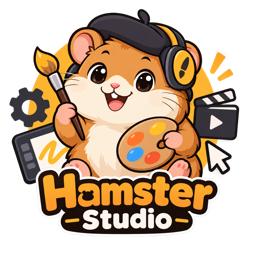

<p align="center">
  
</p>

# Hamster Studio

English · [简体中文](README.zh-CN.md)

Hamster Studio is an open-source desktop app for AI chat and image generation. Connect your own OpenAI Compatible providers using a base URL and API key—no Hamster Studio account required. Switch providers and models within conversations, keep your history locally, and export generated images. The interface supports English and Simplified Chinese, with title search, pinned conversations, and archives for organizing your sessions.

[](https://github.com/xrdavies/hamster-studio/actions/workflows/build-mac.yml)
[](https://github.com/xrdavies/hamster-studio/actions/workflows/format.yml)
[](LICENSE)

[Downloads & release notes](https://github.com/xrdavies/hamster-studio/releases) · [Quick start](#quick-start) · [Report an issue](https://github.com/xrdavies/hamster-studio/issues)

## Download and install

Visit [GitHub Releases](https://github.com/xrdavies/hamster-studio/releases) for available packages and release notes. To try changes that have not been released, follow [Development](#development).

The current packaging target is **macOS DMG**; local builds have been verified on **Apple Silicon (arm64)**. Windows, Linux, and Intel Mac packages are not currently provided. Download a matching DMG, open it, and drag Hamster Studio into Applications.

Local builds without an Apple Developer certificate are unsigned. Release signing and notarization depend on the repository's Apple credentials; consult the release notes for the status of each published package. See [BUILD.md](BUILD.md) for local packaging details.

## Quick start

1. Open **Settings → Providers → Add**.
2. Enter a name, your provider's **Base URL**, and your **API key**. A typical base URL is `https://api.example.com/v1`.
3. Click **Fetch provider models**. Fetching happens only when you request it. You can also add model IDs manually and remove models from the list, then save the provider.
4. Create a conversation and choose a provider and model in the input area. The icon indicates whether it is a chat or image generation model.
5. Send a message or describe an image. Use **Export image** below a generated image to save a copy.

Use **Enter** to send and **Shift + Enter** for a new line. Change the interface language under **Settings → General → Language**; your choice is saved locally.

## Image creation and webpage reading

- **Create through conversation:** use a chat model with tool-calling support and select an image model in the composer’s image settings. Inspecting images also requires a vision-capable chat model.
- **Add references:** select or drag in up to 4 PNG, JPEG or WebP images, each up to 10 MB. Ask to combine references or process assets separately.
- **Edit a region:** open the brush action on a reference attachment, paint the area to change, then describe your edit. The image provider must support mask editing; preservation outside the region depends on the model.
- **Region markers:** a smart region marker uses one additional image input, so use at most 3 reference images with a marker.
- **Preview and export:** click a result to view it at full size, export it, or use it as a reference for another edit. Originals are preserved.
- **Read a webpage:** provide a public URL and ask for a summary. HTML and plain text are supported; login pages, JavaScript rendering and PDFs are not.

Interrupted replies can offer a continuation action. Image requests with uncertain results require confirmation before another paid attempt.

## PSD editing

- **Attach a PSD:** drag a `.psd` file onto the composer or use the layers button next to the image button (PSD up to 512 MB; PSB is not supported). Hamster Studio keeps its own copy; your original file is not modified.
- **Describe the edit:** for example, change a text layer, hide or rename layers, add an adjustment layer or resize the canvas. Use a chat model with tool-calling support; checking the result also requires vision.
- **Versions:** every edit saves a new layered version shown as a card with a preview. Earlier versions stay available.
- **Save the result:** use **Save PSD as…**, **Export PNG**, or **Replace original**, which asks for confirmation and refuses if the original changed after you attached it.
- **Exact image edits:** the same local editor can resize to exact pixels, crop, rotate, blur or adjust colours on regular images without using an image model.

Local edits are free and run entirely on your Mac. Previews are rendered by the bundled editor and may differ from Photoshop for unusual effects or missing fonts. Content the editor cannot read (for example some smart filter masks) is listed as a warning on the card and is not kept in edited versions.

### Provider compatibility

Providers need the endpoints required by your workflow: `/models` for model discovery, streaming `/chat/completions` for chat, `/images/generations` for generation, and `/images/edits` for reference images and region edits. Support for tool calling, vision, multiple references and masks varies by provider and model. Model availability and usage charges are determined by your provider.

## Data and privacy

- Conversations and provider configuration are stored in `studio.db` within Tauri's application data directory; generated images are stored in its `images/` subdirectory and attached PSD copies and their versions in `documents/`. They are deleted with their conversation.
- AI requests go directly from the desktop app to your configured provider. Hamster Studio does not require an account or a hosted application backend.
- API keys are stored in the system credential store (macOS Keychain); errors never fall back to plaintext.
- Image inputs and extracted webpage text are sent to your configured conversation provider. For PSDs, only a preview image and a summary of the layers (names, kinds, visibility and text) are sent; the PSD file and its location on disk are not. Webpage reading contacts the target site; proxy Fake-IP resolution may query Cloudflare DNS over HTTPS with the hostname.
- Update checks contact GitHub. Opening project or author links launches your system browser.

Deleting a provider preserves existing conversations. Select another provider and model to continue them.

## Development

Use **Node.js 24**, npm, Rust stable (via rustup), and Xcode Command Line Tools on macOS. The app is built with Tauri, React, TypeScript, and Vite.

```bash
git clone https://github.com/xrdavies/hamster-studio.git
cd hamster-studio
npm ci
npm run dev
```

| Command                    | Purpose                                           |
| -------------------------- | ------------------------------------------------- |
| `npm run dev`              | Start the desktop app in development mode         |
| `npm run format`           | Format source and documentation with Prettier     |
| `npm run format:check`     | Check formatting                                  |
| `npm run typecheck`        | Check TypeScript types                            |
| `npm test`                 | Run frontend tests                                |
| `npm run test:rust`        | Run backend tests                                 |
| `npm run build:renderer`   | Build the React frontend                          |
| `npm run build:dir`        | Compile the native executable without bundling    |
| `npm run build:photocraft` | Build the bundled PSD editor at the pinned commit |
| `npm run build`            | Build the Tauri application and macOS DMG         |

Build output is written to `src-tauri/target/release/bundle/`. Translation dictionaries live in `src/shared/locales/`. The Agent system prompt lives in `src-tauri/prompts/image-agent.txt` and is embedded at compile time.

PSD editing uses [PhotoCraft](https://github.com/storytold/photocraft), bundled as a sidecar. `src-tauri/photocraft.json` pins the commit and Rust toolchain; `npm run build:photocraft` fetches that commit, installs the toolchain with rustup if needed, and writes the binary and its license files to `src-tauri/binaries/` (git-ignored). `npm run build` does this automatically. `npm run dev` and `npm run test:rust` work without it; PSD editing is then unavailable and the integration tests are skipped. Set `HAMSTER_PHOTOCRAFT_CLI` to use another binary, `HAMSTER_PHOTOCRAFT_SRC` to build a local checkout, or `HAMSTER_TEST_PSD` to run the integration test against a real PSD. A weekly workflow opens a pull request that moves the pin once the tests pass.

### Release

From a clean `main` checkout:

```bash
npm run release -- patch
```

Use `minor`, `major` or an explicit version instead of `patch` when needed. The command prepares version changes, commits, tags and pushes. GitHub Actions then builds, signs and publishes the release; signing credentials must be configured first.

### Documentation

| Document                                    | Contents                                                 |
| ------------------------------------------- | -------------------------------------------------------- |
| [Build guide](BUILD.md)                     | Local builds, developer tools and implementation details |
| [Release guide](RELEASE.md)                 | Release preparation, signing and updater packages        |
| [Model capabilities](MODEL_CAPABILITIES.md) | Classification rules and catalog updates                 |
| [Changelog](CHANGELOG.md)                   | Development changes, maintained in Chinese               |

## Contributing

Bug reports and feature requests are welcome in [GitHub Issues](https://github.com/xrdavies/hamster-studio/issues). Include your app version, operating system, reproduction steps, and expected behavior. Remove API keys and private content from logs before sharing them.

For pull requests, keep changes focused, use [Conventional Commits](https://www.conventionalcommits.org/), and run formatting checks, type checks, tests, and the renderer build before submitting.

## Author and acknowledgments

Created by **Frozen** · [X / @xrdavies](https://x.com/xrdavies).

Thanks to Tauri, React, Vite, Lucide, rusqlite, react-markdown, and the other open-source projects used by Hamster Studio. PSD editing is powered by [PhotoCraft](https://github.com/storytold/photocraft) by ArtCraft, licensed under MIT or Apache-2.0; its license files ship inside the app. Dependencies retain their respective licenses.

## License

[MIT](LICENSE) · Copyright © 2026 Frozen.
